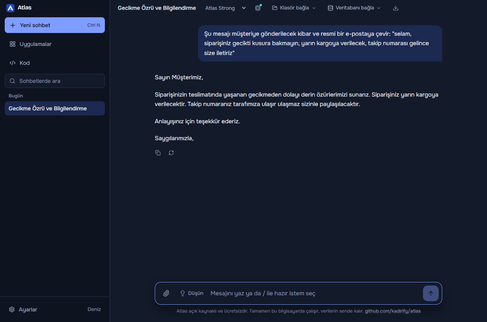

<p align="center">
  
</p>

<h1 align="center">Atlas</h1>

<p align="center">
  A Turkish-first AI assistant that runs entirely on your own computer.<br>
  Your data never leaves your machine. Free and open source.
</p>

<p align="center">
  <a href="docs/en/what-is-atlas.md">What is Atlas?</a> ·
  <a href="docs/en/models.md">Models</a> ·
  <a href="docs/en/training.md">How the models were trained</a> ·
  <a href="README.md">Türkçe</a>
</p>

<p align="center">
  
</p>

## Why Atlas?

Cloud AI assistants are powerful, but you can't always paste a contract, a customer list or your source code into someone else's server. Atlas is built for that gap:

- **Your data stays with you.** Questions, files and chats never leave your computer. No account, no subscription.
- **No internet needed.** After setup it works on a plane, on site, or on an air-gapped network.
- **Good at Turkish.** Atlas ships its own models, fine-tuned for Turkish; they are clearly better than their base models at Turkish spelling and grammar correction. English works too.
- **It does real work.** It reads your documents, edits your code, queries your database and fixes text you select in any app.
- **Free.** The app is MIT-licensed, the models are Apache 2.0.

## What can it do?

| | |
| --- | --- |
| **Chat and writing** | Emails, reports, summaries, translations, formal letters, Turkish proofreading, an optional "think first" mode. |
| **Documents** | Attach PDF, Word and Excel files; open them side by side, select a passage and have it fixed. Changes are shown red and green before anything is applied. |
| **Code area** | Open a project folder: Atlas reads files, writes a plan, applies changes after your approval, runs your tests and checks the result. |
| **Databases** | SQL Server, PostgreSQL, MySQL and SQLite. Ask in plain language, Atlas writes the query. SELECT runs freely, changes need approval, DELETE, DROP and TRUNCATE never run. |
| **Apps** | One-click mini apps for meeting minutes, formal letters, email replies and more; build your own with the prompt studio. |
| **Desktop** | Fix, translate or shorten selected text in any program with a shortcut. A quick-ask window from anywhere. System tray and app lock. |

## Atlas models

| Model | Base | Size | Spelling test: base → Atlas | General score |
| --- | --- | ---: | ---: | ---: |
| [Atlas Light](https://ollama.com/kadirify/atlas-light) | Qwen 3.5 4B | 3.5 GB | 35% → **83%** | 92 |
| [Atlas Medium](https://ollama.com/kadirify/atlas-medium) | Gemma 4 E4B | 7.3 GB | 65% → **88%** | 97 |
| [Atlas Strong](https://ollama.com/kadirify/atlas-strong) | Gemma 4 12B | 9.2 GB | 66% → **85%** | 98 |
| [Atlas Code](https://ollama.com/kadirify/atlas-code) | Qwen2.5-Coder 14B | 9.0 GB | 32% → **77%** | 91 |

The models are not trained from scratch: they are LoRA fine-tunes of open models, trained on a single home PC with a 12 GB graphics card. Data, method, results and what did not work: [How the Atlas models were trained](docs/en/training.md).

They also work outside Atlas:

```bash
ollama run kadirify/atlas-strong
```

## Install

1. Download `Atlas-Setup` from the [Releases](https://github.com/Kadirify/atlas/releases) page and run it.
2. On first launch a wizard scans your hardware, installs [Ollama](https://ollama.com) and downloads the Atlas model that fits your computer.

Requirements: Windows 10/11, at least 8 GB of RAM. A graphics card is optional but makes a big difference. The installer is not code-signed, so Windows may show an "unknown publisher" warning.

## Privacy

Atlas only goes online in two cases: when it downloads Ollama and a model during setup, and when you press "Check for updates". Neither sends anything about you.

## For developers

```bash
npm install
npm run dev        # development mode
npm test           # unit tests
npm run typecheck  # type checks
npm run dist       # Windows installer
```

Architecture (Turkish): [docs/mimari.md](docs/mimari.md) · Contributing (Turkish): [CONTRIBUTING.md](CONTRIBUTING.md) · Security: [SECURITY.md](SECURITY.md)

## Status

Atlas is an early release (0.1). It is usable for everyday work, but local models are not as strong as cloud models and can make mistakes in long, multi-step tasks. Windows only for now.

## Development note

[Claude](https://www.anthropic.com/claude) (Anthropic) was used as an AI-assisted development tool while building Atlas.

## License

The app is [MIT](LICENSE) licensed. The Atlas models are Apache 2.0, like their base models. Thanks to Google DeepMind (Gemma) and the Alibaba Qwen team for the base models.
