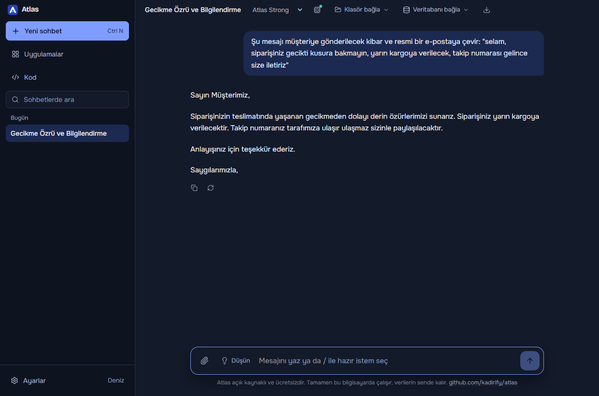
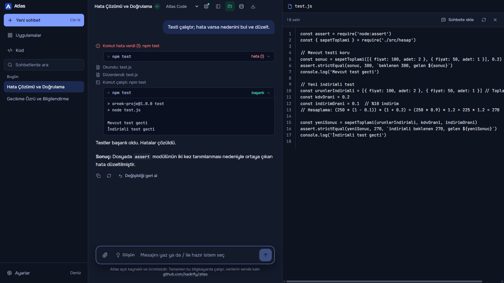

<p align="center">
  
</p>

<h1 align="center">Atlas</h1>

<p align="center">
  Bilgisayarında, internetsiz çalışan Türkçe yapay zeka asistanı.<br>
  Verin bilgisayarından çıkmaz. Ücretsiz ve açık kaynak.
</p>

<p align="center">
  <a href="docs/atlas-nedir.md">Atlas nedir?</a> ·
  <a href="docs/ozellikler.md">Özellikler</a> ·
  <a href="docs/kurulum.md">Kurulum</a> ·
  <a href="docs/modeller.md">Modeller</a> ·
  <a href="docs/egitim.md">Nasıl eğitildi?</a> ·
  <a href="README.en.md">English</a>
</p>

<p align="center">
  
</p>

## Neden Atlas?

Bulut tabanlı yapay zeka asistanları güçlü, ama sözleşmeni, müşteri listeni ya da kaynak kodunu bir sunucuya yapıştırmak her zaman mümkün değil. Atlas bunun için var:

- **Verin sende kalır.** Sorular, dosyalar ve sohbetler bilgisayarından çıkmaz. Hesap yok, abonelik yok.
- **İnternet gerekmez.** Kurulumdan sonra uçakta, sahada, kapalı ağda çalışır.
- **Türkçeyi iyi bilir.** Atlas'ın kendi modelleri Türkçe için ayrıca eğitildi; yazım düzeltmede taban modellerden belirgin şekilde iyi.
- **İş yapar.** Belgelerini okur, kodunu düzenler, veritabanına sorgu atar, her programda seçtiğin metni düzeltir.
- **Ücretsiz.** Uygulama MIT, modeller Apache 2.0 lisanslı.

## Neler yapabilir?

| | |
| --- | --- |
| **Sohbet ve yazı** | E-posta, rapor, özet, çeviri, resmi yazı. Türkçe yazım düzeltme. Düşünerek cevap verme kipi. |
| **Belgeler** | PDF, Word ve Excel'i sohbete ekle; belgeyi yanda aç, bir bölümünü seç, düzelttir. Değişiklikler kırmızı-yeşil gösterilir. |
| **Kod alanı** | Bir proje klasörü aç; Atlas dosyaları okur, plan yapar, değişikliği onayınla yazar, testi çalıştırıp sonucu kontrol eder. |
| **Veritabanı** | SQL Server, PostgreSQL, MySQL, SQLite. Sorunu Türkçe sor, sorguyu o yazsın. SELECT serbest, değişiklik onaylı, silme yok. |
| **Uygulamalar** | Tutanak, resmi yazı, e-posta cevabı gibi işler için tek tıkla çalışan küçük uygulamalar; kendininkini de yaparsın. |
| **Masaüstü** | Her programda seçili metni kısayolla düzelt, çevir, kısalt. Her yerden açılan soru penceresi. Sistem tepsisi, kilit. |

<p align="center">
  
</p>

Bütün özellikler: [docs/ozellikler.md](docs/ozellikler.md)

## Atlas modelleri

Atlas kendi model ailesiyle çalışır. Her biri açık bir taban modelin Türkçe için ince ayar yapılmış hâli; eğitim tek bir ev bilgisayarında, 12 GB'lık bir ekran kartıyla yapıldı.

| Model | Taban | Boyut | Yazım testi: taban → Atlas | Genel ölçüm |
| --- | --- | ---: | ---: | ---: |
| [Atlas Light](https://ollama.com/kadirify/atlas-light) | Qwen 3.5 4B | 3,5 GB | %35 → **%83** | 92 |
| [Atlas Medium](https://ollama.com/kadirify/atlas-medium) | Gemma 4 E4B | 7,3 GB | %65 → **%88** | 97 |
| [Atlas Strong](https://ollama.com/kadirify/atlas-strong) | Gemma 4 12B | 9,2 GB | %66 → **%85** | 98 |
| [Atlas Code](https://ollama.com/kadirify/atlas-code) | Qwen2.5-Coder 14B | 9,0 GB | %32 → **%77** | 91 |

Veri, yöntem, sonuçlar ve işe yaramayan denemeler: [Atlas modelleri nasıl eğitildi?](docs/egitim.md)

Modeller Atlas dışında da kullanılabilir:

```bash
ollama run kadirify/atlas-strong
```

## Kurulum

1. [Sürümler](https://github.com/Kadirify/atlas/releases) sayfasından `Atlas-Setup` dosyasını indirip çalıştır.
2. İlk açılışta sihirbaz bilgisayarını tarar, [Ollama](https://ollama.com)'yı kurar ve donanımına uygun Atlas modelini indirir.

Gereksinimler: Windows 10/11, en az 8 GB bellek. Ekran kartı şart değil ama çok fark eder. Kurulum dosyası imzalı olmadığı için Windows "Bilinmeyen yayıncı" uyarısı gösterebilir. Ayrıntı: [docs/kurulum.md](docs/kurulum.md)

## Gizlilik

Atlas yalnızca iki durumda internete çıkar: kurulumda Ollama'yı ve modeli indirirken, ve yeni sürüm var mı diye GitHub'a bakarken (açılışta ve günde bir kez; ayarlardan kapatılabilir). İkisinde de seninle ilgili hiçbir bilgi gönderilmez. Ayrıntı: [docs/gizlilik-ve-guvenlik.md](docs/gizlilik-ve-guvenlik.md)

## Geliştiriciler için

```bash
npm install
npm run dev        # geliştirme modu
npm test           # birim testleri
npm run typecheck  # tip denetimi
npm run dist       # Windows kurulum dosyası
```

Mimari: [docs/mimari.md](docs/mimari.md) · Katkı: [CONTRIBUTING.md](CONTRIBUTING.md) · Değişiklikler: [CHANGELOG.md](CHANGELOG.md) · Güvenlik açığı bildirmek: [SECURITY.md](SECURITY.md)

## Durum

Atlas erken bir sürümde (0.2). Günlük işlerde kullanılabilir durumda, ama yerel modeller bulut modelleri kadar güçlü değil ve uzun, çok adımlı işlerde hata yapabilir. Bilinen sınırlar ve yol haritası: [docs/yol-haritasi.md](docs/yol-haritasi.md)

## Geliştirme notu

Atlas'ın geliştirilmesinde yapay zeka destekli geliştirme aracı olarak [Claude](https://www.anthropic.com/claude) (Anthropic) kullanıldı.

## Lisans

Uygulama [MIT](LICENSE) lisanslı. Atlas modelleri, taban modelleri gibi Apache 2.0 lisanslı ([ayrıntı](docs/modeller.md#lisanslar)). Kurulum dosyasındaki açık kaynak yazılımların lisansları uygulamada **Ayarlar → Hakkında → Açık kaynak bildirimleri** altında.
Taban modeller için Google DeepMind'a (Gemma) ve Alibaba Qwen ekibine teşekkürler.
